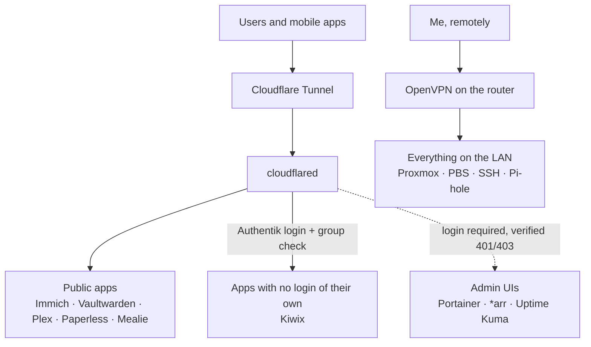
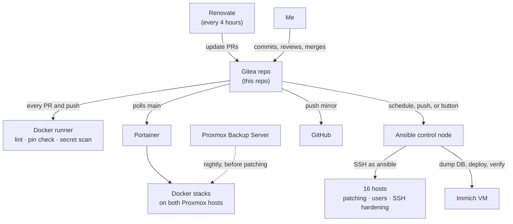

# Skynet Homelab

Infrastructure-as-code for a two-node Proxmox homelab that runs ~25 self-hosted services for my
household: photos, passwords, documents, media, and the tooling to run it all. Every Docker stack,
every host's OS configuration, and every update decision lives in this repo. **Hosts converge on
`main`: nothing is changed on a server by hand.**

I built this to learn, and to practice the way production infrastructure is run: GitOps, automated
dependency updates with review gates, configuration management, least-privilege access, and backups
that are actually restored.

## Highlights

- **GitOps deployments.** Portainer redeploys Docker stacks from `main`. Ansible deploys the one
  VM-based app (Immich), runs Portainer itself (one server, six agents, one pinned version) and
  manages the OS on every host.
- **Automated, reviewable updates.** Every image is pinned, and Renovate turns each upstream
  release into a pull request.
  - Low-risk apps **auto-merge** once CI passes and the release is 3 days old.
  - Stateful apps wait for review. Immich upgrades take a **database dump**, deploy, and then
    **verify the running version** through the app's API.
- **Fleet patching with Ansible.** 16 hosts (Proxmox VE/PBS, LXCs, a VM, Raspberry Pis) are
  patched weekly, after the nightly backups. Hosts go one at a time, and the run stops at the first
  failure.
- **Backups with retention and least privilege.**
  - Every LXC and VM goes to Proxmox Backup Server nightly, each host in its own namespace, pruned
    to 7 daily / 4 weekly / 6 monthly.
  - Bind-mounted data that Proxmox backups skip (Gitea, Immich photos, the offline library) is sent
    by an Ansible-managed job with a backup-only API token. Nightly runs read only changed files;
    a weekly run reads everything.
- **Offline knowledge library.** A "survival" LXC serves Wikipedia (full, with images), medical,
  repair and preparedness references with Kiwix. A monthly job downloads new versions, checks
  their checksum and size, and never deletes an old copy, so nothing removed upstream is lost here.
- **SSH hardening across the fleet.**
  - No root logins and no password logins: keys only, served from a password manager's SSH agent.
  - A break-glass account that works only from the LAN or VPN.
  - Rolled out with automated config checks, simulated logins (`sshd -T -C`) and **automatic
    rollback**.
- **No open inbound ports.** Public apps go through one Cloudflare Tunnel (consolidated from 22).
  Admin UIs are tested to reject unauthenticated access; everything else is VPN-only.
- **No login bypass on the LAN.** Apps with no login of their own sit behind Authentik's proxy, and
  a Proxmox firewall rule (enforced on the host, outside the container) lets only Authentik reach
  them. Typing the app's IP on the home network times out.
- **CI on every change.** Each compose file is validated, `:latest` tags are rejected, playbooks are
  syntax-checked and linted, and committed secrets fail the build.
- **Secrets stay out of Git.** Portainer variables, a mode-600 file on the Ansible control node,
  and a password manager. The repo's history was rewritten to remove personal data before
  publishing.

## Architecture

### How traffic gets in

No ports are open on the router. Public apps arrive through an outbound Cloudflare Tunnel, and
everything administrative needs the VPN.



### How changes get deployed

Every change starts as a commit in Gitea. Runners and Portainer pull work from it.



### How a change reaches production

```
upstream release ─► Renovate PR ─► CI (compose valid, pinned, no secrets, playbooks lint)
                                     │
                     low-risk app ───┴─── stateful app / major version
                     auto-merge            review the release notes, merge
                          │                       │
                          ▼                       ▼
              Portainer redeploys        Portainer redeploys, or for Immich and Portainer itself:
              within 5 minutes           Ansible backs up → deploys → checks health + version
```

More detail: **[docs/architecture.md](docs/architecture.md)** (design and decisions) ·
[docs/ci-cd.md](docs/ci-cd.md) · [ansible/README.md](ansible/README.md) ·
[docs/secrets.md](docs/secrets.md)

## Tech

| Area | Tools |
|---|---|
| Virtualization | Proxmox VE 9 (LXC + KVM), Proxmox Backup Server, virtiofs |
| Containers | Docker, Docker Compose, Portainer (GitOps Git stacks) |
| CI/CD | Gitea, Gitea Actions (Docker + host-mode runners), Renovate |
| Configuration management | Ansible (ansible-core 2.22, ansible-lint), uv |
| Networking | Cloudflare Tunnel, OpenVPN, Pi-hole + Unbound (recursive DNS), DHCP reservations |
| Identity and secrets | Authentik (OIDC SSO), Vaultwarden (incl. SSH agent), OpenSSH hardening |
| Out-of-band | JetKVM on both Proxmox hosts |

## Hardware

| Host | Hardware | Role |
|---|---|---|
| **skynet** | Dell Precision 5810, 14C/28T, 64 GB ECC, Quadro P2200, 16 TB HDD, 3× 2 TB NVMe | Proxmox VE: media, Gitea, Authentik, CI runners, Ansible |
| **little-skynet** | Dell OptiPlex 7050, 16 GB, 4 TB HDD, 2 TB NVMe | Proxmox VE: Portainer, household apps, Immich VM, cloudflared |
| **pbs** | Toshiba Qosmio (2013), 12 GB, 4 TB USB HDD | Proxmox Backup Server |
| **pi2 / pi4** | Raspberry Pi 2 / Raspberry Pi 4 + 2 TB SSD | DNS (Pi-hole + Unbound) / critical-data backups |
| — | 2× JetKVM, ASUS RT-AX1800S | Out-of-band console / router, DHCP, OpenVPN |

## Repository layout

```
stacks/<host>/<app>/compose.yaml   one Docker stack each (+ .env.example listing its secrets)
stacks/shared/cloudflared/         the Cloudflare tunnel connector
stacks/little-skynet/immich/       deployed by Ansible, not Portainer
ansible/                           inventory, playbooks, bootstrap scripts (see ansible/README.md)
  playbooks/  ping · patch-guests · patch-hosts · users · harden-ssh · timezone · docker ·
              immich · portainer · portainer-discover · docker-cleanup · host-backup ·
              kiwix-update
  templates/  scripts and systemd units the playbooks install (host-backup, kiwix-update)
.gitea/workflows/
  lint.yml        compose validation, pin check, secret scan, ansible syntax + lint
  renovate.yml    Renovate every 4 hours
  ansible.yml     weekly patching, any playbook on demand (dry run by default)
  deploy-immich.yml, deploy-portainer.yml   deploy on merge
.gitea/actions/setup-ansible/   shared: pinned Ansible on the control node
renovate.json     update policy: what auto-merges, what waits for review, what's locked
docs/             architecture, CI/CD, secrets
```

## Operations reference

### Deploying a Docker stack (Portainer GitOps)

1. Portainer → environment (host) → **Stacks → Add stack → Repository**, using the internal Gitea
   URL and a read-only Gitea token.
2. Reference `refs/heads/main`, compose path `stacks/<host>/<app>/compose.yaml`.
3. Environment variables: everything in that stack's `.env.example`.
4. **GitOps updates → Polling** (5 min). Merging to `main` redeploys.

Conventions:
- **Secrets:** come in through `${VAR}` (`${VAR:?msg}` when required). Git stacks don't get a
  `stack.env`.
- **Restarts and time:** `restart: unless-stopped`, `TZ=America/Los_Angeles`.
- **Data:** in bind mounts, so it survives stack renames.
- **Names:** every `container_name` is unique.

### Network

LAN `192.168.50.0/24`. Every address is a DHCP reservation.

| Device | Hostname | IP |
|---|---|---|
| Pi-hole + Unbound (Pi 2) | DNS-Skynet | 192.168.50.2 |
| Proxmox host: skynet | Skynet | 192.168.50.8 |
| JetKVM #2 | Jet-KVM2 | 192.168.50.18 |
| cloudflared | CloudFlare | 192.168.50.27 |
| Critical-data backup (Pi 4) | Skynet-Data-recover | 192.168.50.75 |
| Proxmox Backup Server | PBS | 192.168.50.76 |
| Portainer + little-skynet stacks | Portainer-Lsky | 192.168.50.81 |
| Plex | Video-Captin | 192.168.50.88 |
| Gitea Actions runner (lint, Renovate) | gitea-runner | 192.168.50.90 |
| Immich (VM) | Immich | 192.168.50.106 |
| Gitea | gittea-repo | 192.168.50.124 |
| Ansible control node | Ansible | 192.168.50.129 |
| Survival LXC (offline Wikipedia) | survival | 192.168.50.131 |
| JetKVM #1 | Jet-KVM | 192.168.50.150 |
| Authentik | Authentik | 192.168.50.151 |
| Living room printer | Living-Room-Printer | 192.168.50.166 |
| Arr stack (media apps) | Arr-Stack | 192.168.50.199 |
| Proxmox host: little-skynet | Little-Skynet | 192.168.50.220 |
| File Browser | File-Browser | 192.168.50.246 |

### Services

What each label means:
- **Public:** published through the tunnel.
- **Behind Authentik:** public, but the tunnel sends it to Authentik's proxy, which requires a login
  and membership of the app's group before passing the request on.
- **Admin:** reachable through the tunnel, but the hostname isn't listed, and the app's own login is
  required (verified to return 401/403 without credentials).
- **LAN/VPN:** not exposed at all.

| Service | Runs on | Internal URL | Exposure |
|---|---|---|---|
| Plex | Video-Captin | http://192.168.50.88:32400 | Public |
| Immich | Immich | http://192.168.50.106:2283 | Public |
| Vaultwarden | Portainer-Lsky | http://192.168.50.81:8123 | Public |
| Paperless-ngx | Portainer-Lsky | http://192.168.50.81:8010 | Public |
| Mealie | Portainer-Lsky | http://192.168.50.81:9925 | Public |
| Audiobookshelf | Arr-Stack | http://192.168.50.199:13378 | Public |
| Overseerr | Arr-Stack | http://192.168.50.199:5055 | Public |
| Gitea | gittea-repo | http://192.168.50.124:3000 | Public |
| Kiwix (offline Wikipedia) | survival | http://192.168.50.131:8080 (only Authentik may connect) | Behind Authentik, also from the LAN |
| Authentik (SSO) | Authentik | http://192.168.50.151:9000 | Public |
| Portainer | Portainer-Lsky | https://192.168.50.81:9443 | Admin |
| Uptime Kuma | Portainer-Lsky | http://192.168.50.81:3001 | Admin |
| Sonarr / Radarr / Prowlarr | Arr-Stack | http://192.168.50.199:8989 / 7878 / 9696 | Admin |
| SABnzbd / qBittorrent | Arr-Stack | http://192.168.50.199:8080 / 8888 | Admin |
| Requestrr | Arr-Stack | http://192.168.50.199:4545 | Admin |
| File Browser | File-Browser | http://192.168.50.246:8080 | Admin |
| Homepage, Tautulli | Portainer-Lsky | http://192.168.50.81:4000 / 8181 | LAN/VPN |
| Pi-hole | DNS-Skynet | http://192.168.50.2/admin | LAN/VPN |
| Proxmox VE | Skynet / Little-Skynet | https://192.168.50.8:8006 / .220:8006 | LAN/VPN |
| Proxmox Backup Server | PBS | https://192.168.50.76:8007 | LAN/VPN |
| JetKVM (out-of-band) | Jet-KVM / Jet-KVM2 | http://192.168.50.150 / .18 | LAN/VPN |

## Roadmap

- [x] One repo; secrets out of Git; history cleaned for publishing
- [x] One Cloudflare tunnel (from 22); admin apps verified to require login
- [x] Pinned images, Renovate, CI lint, tiered auto-merge
- [x] Ansible control node; weekly patching after backups; Proxmox/PBS patching
- [x] Admin + break-glass accounts and SSH hardening on all 16 hosts
- [x] Immich: reviewed upgrades with pre-update DB dumps, health and version checks
- [x] Portainer: one server + standard agents on one pinned version, managed by Ansible, deployed on merge
- [x] Docker CE on every Docker host (moved the last three LXCs off Debian's docker.io 20.10)
- [x] PBS per-host namespaces, prune jobs, and backups of bind-mounted host data
- [x] Offline knowledge LXC: Kiwix with monthly, checksum-verified, never-deleting updates
- [x] One timezone (Pacific) on every machine, set by Ansible
- [x] Kiwix public behind Authentik (proxy outpost, group-restricted)
- [x] Proxmox firewall on the survival LXC: only Authentik can reach Kiwix, so the LAN can't skip the login
- [ ] LAN entry point (reverse proxy + split DNS) so logins also work with the internet down
- [ ] Scheduled restore test from PBS (restore a guest and the host-backup archives, check they start)
- [ ] Monitoring and alerting (failed jobs, backups, disk health → push notifications)
- [ ] Gitea, Authentik, Plex, Pi-hole as code in this repo
- [ ] Managed switch + VLANs (management / servers / trusted / IoT / guest)
- [ ] Offsite backups and a UPS
